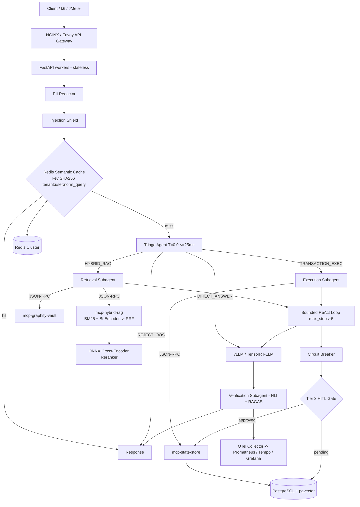

# design.md — The Unreliable Assistant → Enterprise Grade

> Gate 1 artifact (HARD GATE). Sources: *Unreliable_Assistant_MidCheck_Enterprise_Blueprint_v2.docx* (the spec),
> *Post_Hardening_Engineering_Audit_Report.docx* (the final report this build must be able to evidence),
> *SLM_Comprehensive_Guide.docx* (informs the triage-model decision, ADR-05).
> Values marked **(proposed)** are not specified by the sources and need review before lock.
> Conflicts between sources are resolved in [Open Items](#open-items--resolved-conflicts).

## Contents
- **Part A — Requirements**: [Mission](#a1-mission-mandate) · [Build order](#a2-gate-overview--build-order) · [Deliverables](#a3-deliverables-checklist)
- **Part B — Design (Gate 1)**: [0 Stack](#0-overview--stack-gate-0) · [1.1 Charter](#11-system-charter--hard-boundaries) · [1.2 Contracts](#12-mcp-tool--data-contracts) · [1.3 Topology](#13-distributed-topology--data-flow) · [1.4 Latency](#14-end-to-end-latency-budget-200600-ms) · [1.5 KPIs](#15-kpi--sla-gate-matrix-36-kpis) · [1.6 FMEA](#16-failure-mode--effects-analysis-fmea) · [1.7 ADRs](#17-architecture-decision-records)
- **Part C — Additions**: [Golden dataset & gates](#c1-evaluation-datasets) · [Audit-report evidence plan](#c2-audit-report-evidence-plan) · [Appendices](#appendix-a--governance-security--red-team-gates-1314) · [Open items](#open-items--resolved-conflicts)

---

# PART A — REQUIREMENTS

## A1. Mission Mandate
Inherit **The Unreliable Assistant**, a fragile prototype with: hallucinated facts (38.6% hallucination baseline), runaway tool loops, cross-user cache leaks, context drift, and latency collapse (up to 7,100 ms under load; crashed at 120 VUs).

**Rule:** before any application code, author this `design.md` (Gate 1) and generate `docs/workflow_orchestration.png` (Gate 2).
**Outcome:** an enterprise-grade, MCP-enabled, plugin-extensible agentic system verified at **50,000 concurrent VUs**, **200–600 ms** latency, and audited across **36 KPIs**.

## A2. Gate Overview & Build Order

| Phase | Gate(s) | Focus | Primary artifact |
|---|---|---|---|
| Pre-build | 1 | Design contract (HARD GATE) | `design.md` |
| Pre-build | 2 | Workflow diagram | `docs/workflow_orchestration.png` |
| Foundation | 0 | Stack, MCP, plugins | `mcp_config.json` |
| Core | 3, 8 | 3-stage hybrid RAG + RAGAS | `mcp_servers/rag_server.py` |
| Core | 4, 5 | Harness, bounded loop, context retention | `ToolExecutionHarness`, `GoalAnchorBlock` |
| Core | 6, 7 | Triage + subagents | Triage agent, 3 subagents |
| Hardening | 9 | Breaker, bulkheads, abstention, HITL | plugins + pools |
| Hardening | 10, 11 | Observability + incident runbooks | OTel pipeline |
| Verification | 12 | 36 KPIs | CI/CD gate + Tab 6 scorecard |
| Verification | 13, 14 | Governance + 100-prompt red team | Audit chain, red-team suite |
| Verification | 15, 16 | 50K load testing | `k6_50k_load.js`, `jmeter_50k_plan.jmx` |
| Optimization | 17 | Obsidian + Graphify token reduction | `knowledge_vault/`, `graph.json` |
| Delivery | 18 | 6-tab Streamlit workbench | `app.py` |
| Closing | — | Post-hardening audit report | `docs/audit_report.md` |

## A3. Deliverables Checklist
_Status: built as a stubbed end-to-end system (see README.md and `docs/audit_report.md`). Ticked = exists and is tested; notes say what is stubbed or not run._

- [x] `design.md` — 7 sections *(this file; lock after review)*
- [x] `docs/workflow_orchestration.png` — 300 DPI, 4 zones (`scripts/gen_workflow.py`)
- [x] `mcp_config.json` — 3 MCP servers + 5 plugins
- [x] `mcp_servers/rag_server.py` (BM25 → Dense → RRF → Cross-Encoder), `graphify_server.py`, state-store server
- [x] `ToolExecutionHarness` (validation, auto-repair, RBAC, idempotency)
- [x] Bounded ReAct state machine (5 iterations / 120 ms step / 450 ms budget)
- [x] `GoalAnchorBlock`, observation compressor (≤180 tok), dual memory (`session_facts`)
- [x] Triage agent (ADR-05) + Retrieval / Execution / Verification subagents *(TF-IDF/LR fallback; SLM fine-tune not run)*
- [x] Circuit breaker, bulkheads, abstention short-circuit, async HITL gate
- [x] OTel instrumentation (10 spans) + Prometheus / Tempo / Grafana *(all 10 blueprint spans are emitted: hook.pre, cache.lookup, triage.classify, mcp.rag.bm25/biencoder/rrf/rerank, agent.react.step, llm.generate, hook.post.ragas; exported in-process / JSONL only - no Collector, Prometheus, Tempo or Grafana deployed)*
- [x] 4 incident runbooks with automated alerts *(runbook toggles implemented: strict rerank, semantic cache, breaker reset, plugin toggles; alert rules not deployed)*
- [x] 250-question RAGAS golden dataset + 5 release gates *(real ragas scoring on a stratified live sample; see docs/audit_report.md 4c)*
- [x] 36-KPI CI/CD gate + scorecard *(`eval/run_kpis.py`; 7 KPIs pending)*
- [x] Hash-chained audit log, tenant isolation, zero raw PII, signed MCP manifests *(Ed25519 over tool list + SHA-256 of source files; verified at start-up and via `GET /api/v1/mcp/verify`; fail-closed; `scripts/sign_manifests.py`, re-run after changing a server or the code it imports)*
- [x] 100-prompt red-team suite (5 classes)
- [x] `load_tests/k6_50k_load.js`, `load_tests/jmeter_50k_plan.jmx` *(scripts written; 50K run not executed)*
- [x] `knowledge_vault/` atomic notes + `graph.json`
- [x] Model router + live OpenRouter LLM at triage / planner / generator / verifier / direct reply (ADR-06; `agent/router.py`, `agent/llm_agents.py`), offline fakes in `tests/test_llm.py`, live results in `reports/llm_eval.json`
- [x] `app.py` — 6-tab Streamlit workbench (workflow PNG in Tab 1)
- [x] `docs/audit_report.md` — measured results only (see C2) *(generated from measured runs; see report for pending items)*

---

# PART B — DESIGN (GATE 1)

## 0. Overview & Stack (Gate 0)

An MCP-enabled, plugin-extensible agentic assistant that fixes the prototype's hallucinations, runaway tool loops, cross-user cache leaks, context drift and latency collapse. Target: **50,000 concurrent VUs, p95 ≤ 450 ms, p99 ≤ 600 ms, 36 KPIs passing.**

| Layer | Tool / Protocol | MCP Server / Plugin | Justification |
|---|---|---|---|
| Agent runtime & API | Python 3.11, FastAPI, Uvicorn (async) | MCP host client (`mcp.ClientSession`) | Non-blocking I/O for 50K connections |
| Sparse + dense retrieval | Rank-BM25, FAISS **HNSW** (efSearch 64), BGE-Large | `mcp-hybrid-rag` (resources + tools) | Exposes `rag://chunks/{id}` and `hybrid_retrieve` |
| Reranker | ONNX Runtime `bge-reranker-v2-m3` FP16 | In-process ONNX / Triton service | ≤ 45 ms cross-encoder (KPI-09), dynamic batching |
| Triage model | Small LM, see ADR-05 | In-process classifier | ≤ 25 ms, temperature 0.0 |
| State & cache | PostgreSQL (pgvector) + Redis Cluster | `mcp-state-store` | ACID audit + tenant-isolated cache |
| Token compression | Obsidian vault + Graphify | `mcp-graphify-vault` | 1–2 hop wikilink/dependency traversal, −45–65% tokens |
| Lifecycle plugins | Pluggy entry-point registry | pii_redactor, injection_shield, circuit_breaker, ragas_auditor, otel_exporter | Hot-swappable deterministic interceptors |

Transports: JSON-RPC 2.0 over **stdio** (local workers) and **Streamable HTTP/SSE** (distributed services).

**Plugin registry (`mcp_config.json`)**

| Plugin | Stage | Priority | Notes |
|---|---|---|---|
| pii_redactor | PRE_EXECUTION | 10 | fail_closed |
| injection_shield | PRE_EXECUTION | 20 | fail_closed |
| circuit_breaker | TOOL_DISPATCH | 10 | max_identical_calls = 2 |
| ragas_auditor | POST_EXECUTION | 10 | min_faithfulness = 0.92 |
| otel_exporter | ALL_SPANS | — | OTLP `localhost:4317` |

MCP servers: `hybrid-rag` (stdio, timeout 150 ms), `state-store` (streamable-http `:8081/mcp`, pool 200), `graphify-vault` (stdio).

---

## 1.1 System Charter & Hard Boundaries

**Scope**
- Answer enterprise policy/SOP/product questions with grounded, cited responses (3-stage hybrid RAG).
- Execute validated, low-risk workflow transitions through schema-checked MCP tools.
- Abstain deterministically when evidence is insufficient.
- Provide full audit, tracing and KPI evidence for every request.

**Non-goals / hard boundaries**
- **No autonomous clinical, financial or legal execution.** Any Tier 3 (mutating) action requires human-in-the-loop approval.
- No raw PII persisted anywhere (logs, cache, Postgres, traces).
- No cross-tenant data access or cache sharing, ever.
- No unbounded agent loops (max 5 iterations, 450 ms loop budget).
- No ungrounded answers: drafts failing claim-to-chunk verification are vetoed.
- No implementation code before this document is reviewed and locked.

**Personas**

| Persona | Needs | Permissions |
|---|---|---|
| End user / employee | Fast, correct, cited answers | TIER_1_READ |
| Operations user | Submit forms, trigger workflow transitions | TIER_1/2, Tier 3 via HITL |
| Approver / reviewer | Approve or reject pending mutations | HITL queue |
| Platform engineer / SRE | Observability, load tests, runbooks | Read-only telemetry, plugin toggles |
| Security / red-team | Run adversarial suites, audit logs | Audit read |
| Compliance auditor | Verify hash-chained audit trail | Audit read |

---

## 1.2 MCP Tool & Data Contracts

All calls pass through `ToolExecutionHarness`: (1) Pydantic v2 strict validation → (2) deterministic regex auto-repair → (3) RBAC tier check → (4) UUIDv4 idempotency enforcement.

**RBAC tiers:** `TIER_1_READ`, `TIER_2_COMPUTE`, `TIER_3_MUTATE` (HITL-gated).

**Regex constraints & auto-repair**

| Field | Pattern | Repair example |
|---|---|---|
| `sku` | `^SKU-\d{3,}$` | `SKU99` → `SKU-099` |
| `lot_id` | `^LOT-\d{5}$` | `lot 44` → `LOT-00044` |
| `tenant_id` | `^tenant_[A-Za-z0-9_-]{1,64}$` | none (reject) |
| `idempotency_key` | UUIDv4 | none (reject) |

**Pydantic v2 models**

```python
from pydantic import BaseModel, ConfigDict, Field
from typing import Literal
from uuid import UUID

class Base(BaseModel):
    model_config = ConfigDict(strict=True, extra="forbid")

class HybridRetrieveIn(Base):
    tenant_id: str = Field(pattern=r"^tenant_[A-Za-z0-9_-]{1,64}$")
    query: str = Field(min_length=1, max_length=2000)
    top_k_sparse: int = Field(50, ge=1, le=50)
    top_k_dense: int = Field(50, ge=1, le=50)
    rrf_k: int = 60
    rerank_k: int = Field(4, ge=1, le=10)
    threshold: float = Field(0.42, ge=0.0, le=1.0)

class Chunk(Base):
    chunk_id: str
    chunk_hash: str
    text: str
    score: float
    source_uri: str            # rag://chunks/{id}

class HybridRetrieveOut(Base):
    chunks: list[Chunk]        # <= 4
    confidence: float
    abstain: bool              # True if top score < threshold
    stage_ms: dict[str, float] # bm25, dense, rrf, rerank

class StateWriteIn(Base):
    tenant_id: str
    session_id: str
    action: Literal["upsert_fact", "submit_form", "transition", "append_audit"]
    payload: dict
    tier: Literal["TIER_1_READ", "TIER_2_COMPUTE", "TIER_3_MUTATE"]
    idempotency_key: UUID

class GraphifyQueryIn(Base):
    tenant_id: str
    anchor: str
    depth: int = Field(2, ge=1, le=2)
    max_tokens: int = Field(320, le=400)
```

**MCP tools**

| Server | Tool / Resource | Tier | Notes |
|---|---|---|---|
| hybrid-rag | tool `hybrid_retrieve`; resource `rag://chunks/{id}` | 1 | read-only |
| state-store | tools `get_session_facts`, `upsert_fact`, `submit_form`, `transition`, `append_audit` | 1–3 | tenant_id in every query |
| graphify-vault | tool `resolve_subgraph`; resource `vault://notes/{id}` | 1 | depth ≤ 2 |

**Error codes** (JSON-RPC `error.code`) **(proposed)**

| Code | Name | Meaning | Handling |
|---|---|---|---|
| -32602 | INVALID_PARAMS | Schema validation failed after repair | Return remediation prompt |
| -32001 | RBAC_DENIED | Tier not permitted | Reject, audit |
| -32002 | HITL_PENDING | Tier 3 awaiting approval | Return `PENDING_APPROVAL` id |
| -32003 | BREAKER_OPEN | Circuit breaker tripped | `HALTED_BREAKER` |
| -32004 | MCP_TIMEOUT | > 150 ms | Fallback per FMEA |
| -32005 | DUPLICATE_REQUEST | Idempotency key already used | Return original result |
| -32006 | TENANT_MISMATCH | tenant_id ≠ auth context | Reject, security alert |
| -32007 | POLICY_BLOCKED | PII/injection plugin blocked | Refusal |

---

## 1.3 Distributed Topology & Data Flow



**Bulkheads:** `rag_pool=64`, `db_pool=128`, `llm_pool=256` — isolated pools so a slow reranker never starves health checks or triage.

**Subagent isolation**

| Subagent | Servers | Rule |
|---|---|---|
| Retrieval | hybrid-rag, graphify-vault | Read-only; cannot call mutating tools |
| Execution | state-store | No RAG / web access; Tier 3 → HITL freeze |
| Verification | state-store (audit only) | Independent context; vetoes ungrounded drafts |

**Triage output:** `(intent, domain, risk_tier, complexity)` → `DIRECT_ANSWER | HYBRID_RAG | TRANSACTION_EXEC | REJECT_OOS`.

**Loop state machine:** `INIT → TRIAGE → REASONING → TOOL_CALL → OBSERVATION → VERIFY → DONE / HALTED`.

---

## 1.4 End-to-End Latency Budget (200–600 ms)

**Hybrid-RAG path, cache miss** (budgets are p95 ceilings; per-stage KPIs from blueprint, other rows **proposed**):

| Hop | OTel span | Budget (ms) |
|---|---|---|
| Gateway + FastAPI ingress | — | 10 **(proposed)** |
| Pre-hook (PII + injection) | `hook.pre` | 15 |
| Semantic cache lookup | `cache.lookup` | 5 **(proposed)** |
| Triage classification | `triage.classify` | 25 |
| MCP JSON-RPC overhead (×2 calls) | — | 8 (4 each) |
| BM25 (Stage 1) ‖ Bi-encoder+FAISS (Stage 2), parallel | `mcp.rag.bm25` / `mcp.rag.biencoder` | max(12, 25) = 25 |
| RRF fusion | `mcp.rag.rrf` | 3 |
| Cross-encoder rerank | `mcp.rag.rerank` | 45 |
| Graphify subgraph | — | 10 **(proposed)** |
| ReAct control overhead (mean 2.2 steps) | `agent.react.step` | 20 **(proposed)** |
| LLM generation to first token (TTFT) | `llm.generate` | 180 (KPI-25) |
| Streaming remainder of response | — | 60 **(proposed)** |
| Post-hook (RAGAS async, off critical path) | `hook.post.ragas` | 0 on path |
| **Total (p95)** | | **≈ 406 ms ≤ 450** |
| Headroom for queueing at 50K VUs | | ≈ 44 ms |

Shortcuts:
- **Cache hit:** ≈ 10 + 15 + 5 + response ≈ < 60 ms.
- **Abstention short-circuit:** cross-encoder top score < 0.42 → skip LLM, deterministic response **< 90 ms** after retrieval.
- **p99 ≤ 590 ms:** 450 ms p95 + ~140 ms tail allowance (queueing, GC, batch wait up to 8 ms).

**Scaling levers:** stateless FastAPI behind NGINX/Envoy; Redis Cluster; ONNX bi/cross-encoder workers with micro-batching (batch = 32, max_wait = 8 ms); vLLM/TensorRT-LLM with continuous batching + prefix caching.

**Load plan:** k6 (`load_tests/k6_50k_load.js`): 2m→10K, 3m→50K, 5m sustain, 2m ramp-down; thresholds p50<250, p95<450, p99<600, failures<0.05%. JMeter (`load_tests/jmeter_50k_plan.jmx`): 1 controller + 10 workers × 5,000 threads, ramp 180 s, 600 s duration, non-GUI; Duration Assertion 600 ms.

---

## 1.5 KPI & SLA Gate Matrix (36 KPIs)

| # | Stage | KPI | Threshold | Tool |
|---|---|---|---|---|
| 01 | Ingress & Triage | Pre-hook guardrail latency p95 | ≤ 15 ms | OTel `hook.pre` |
| 02 | | PII redaction recall (email/phone/SSN/obfuscated) | ≥ 99.8% | Presidio / regex audit |
| 03 | | Prompt-injection block rate (direct + indirect) | ≥ 99.5% | Red-team benchmark |
| 04 | | Triage routing accuracy | ≥ 97.0% | Labeled intent set |
| 05 | | Triage latency p95 | ≤ 25 ms | OTel `triage` |
| 06 | | False-positive refusal rate (benign) | ≤ 1.0% | Benign control set |
| 07 | Hybrid Retrieval | BM25 latency p95 | ≤ 12 ms | `rag.bm25` |
| 08 | | Bi-encoder + FAISS latency p95 | ≤ 25 ms | `rag.dense` |
| 09 | | Cross-encoder rerank latency p95 | ≤ 45 ms | `rag.rerank` |
| 10 | | Hybrid context recall@50 | ≥ 0.92 | RAGAS / IR eval |
| 11 | | Post-rerank context precision@4 | ≥ 0.88 | RAGAS |
| 12 | | MRR@4 | ≥ 0.85 | IR benchmark |
| 13 | | nDCG@4 | ≥ 0.86 | IR benchmark |
| 14 | Agent & Loop | Tool schema first-pass validation rate | ≥ 96.0% | Pydantic telemetry |
| 15 | | Auto-repair success on malformed args | ≥ 90.0% | Harness metrics |
| 16 | | Infinite-loop escape rate (breaker) | 100% | Chaos loop suite |
| 17 | | Mean ReAct steps per completed task | ≤ 2.2 | OTel trace count |
| 18 | | Context drift score (goal cosine) | ≥ 0.85 | Embedding drift audit |
| 19 | | Tier 3 HITL enforcement rate | 100% | Audit-log integrity |
| 20 | Generation & RAGAS | Faithfulness | ≥ 0.92 | Post-hook RAGAS |
| 21 | | Answer relevancy | ≥ 0.90 | Post-hook RAGAS |
| 22 | | Context entity recall | ≥ 0.85 | Post-hook RAGAS |
| 23 | | Unanswerable-query abstention accuracy | ≥ 98.0% | Negative test set |
| 24 | | Unsupported-claim / hallucination rate | ≤ 0.5% | NLI claim verifier |
| 25 | | TTFT p95 | ≤ 180 ms | FastAPI stream metric |
| 26 | Token & Graphify | Prompt token reduction | ≥ 45.0% | Token counter hook |
| 27 | | Semantic cache hit ratio (steady state) | ≥ 35.0% | Redis hit/miss |
| 28 | | Cross-tenant cache isolation | 100% (0 leaks) | Concurrency probe |
| 29 | | Cost per 1,000 queries | ≤ $0.45 | OTel token cost |
| 30 | | MCP JSON-RPC serialization overhead p95 | ≤ 4 ms | MCP client timer |
| 31 | Scale & Load (50K) | E2E latency p50 | ≤ 240 ms | k6 + JMeter |
| 32 | | E2E latency p95 | ≤ 450 ms | k6 + JMeter |
| 33 | | E2E latency p99 | ≤ 590 ms (<600) | k6 + JMeter |
| 34 | | HTTP 5xx rate | ≤ 0.05% | k6 / JMeter |
| 35 | | Sustained throughput | ≥ 8,500 RPS | k6 / JMeter |
| 36 | | RSS growth over 1-hr soak | ≤ 3.0% | Prometheus node exporter |

**RAGAS release gates** (250-question golden set: Factoid 25%, Complex Reasoning 25%, Multi-Hop 20%, Summary 15%, Negative 15%): Faithfulness ≥ 0.92, Answer Relevancy ≥ 0.90, Context Precision ≥ 0.88, Context Recall ≥ 0.85, Context Entity Recall ≥ 0.85.

---

## 1.6 Failure Mode & Effects Analysis (FMEA)

| # | Failure | Detection | Effect | Deterministic fallback |
|---|---|---|---|---|
| 1 | Redis down / unreachable | Client error, health probe | No cache, higher load | Bypass cache; serve from retrieval; shed load via rate limit; never fall back to a shared/unscoped cache |
| 2 | Reranker timeout (>45 ms budget) | `rag.rerank` span timeout | No Stage 3 scores | Use RRF top-4 with stricter extractive mode and lowered confidence; flag in response |
| 3 | MCP server crash / hang (>150 ms, >1%) | JSON-RPC timeout, heartbeat | Tool unavailable | Trip bulkhead breaker, fail over to cached read-replica index, restart worker |
| 4 | LLM 429 / overload | HTTP 429 | No generation | Exponential backoff with jitter (≤1 retry inside budget), then secondary model/pool, else extractive answer from top chunks |
| 5 | Postgres primary failover | Connection errors | State/audit writes fail | Read from replica; queue writes in durable buffer; Tier 3 mutations **blocked** until audit write succeeds |
| 6 | Cache stampede / cross-tenant key collision | Redis CPU >85%, collision probe | Latency spike / data leak | Enforce `SHA256(tenant:user:norm_query)` prefix, jittered TTL 300 s ± 45 s, single-flight locking |
| 7 | Prompt injection in retrieved chunk | Injection classifier, red-team | Goal hijack | Strip/quarantine chunk, re-run retrieval without it, audit event |
| 8 | PII plugin failure | Plugin exception | PII leakage risk | **fail_closed**: reject request with POLICY_BLOCKED |
| 9 | Runaway tool loop | Breaker: same `(tool, args_hash)` failed ≥2×, or step >5 | Resource burn | `HALTED_BREAKER` with structured remediation prompt |
| 10 | Hallucination surge (faithfulness <0.90, 5 min) | RAGAS window alert | Wrong answers | Raise cross-encoder cutoff 0.42 → 0.55; strict extractive quote mode |
| 11 | HITL reviewer unavailable | Pending age > SLA **(proposed: 15 min)** | Blocked mutations | Keep `PENDING_APPROVAL`; escalate; never auto-approve |
| 12 | Latency breach (p95 >550 ms for 30 s) | Prometheus alert | SLA miss | Semantic cache threshold cosine ≥ 0.92; reduce BM25/dense `top_k` 50 → 25 |

---

## 1.7 Architecture Decision Records

### ADR-01 — Hybrid retrieval weighting
- **Context:** Lexical search misses paraphrase; dense search misses exact IDs/SKUs.
- **Decision:** BM25Okapi (k1 = 1.25, b = 0.75, top 50) + bi-encoder/FAISS (top 50, efSearch 64, 512-token chunks, 64 overlap), fused with **RRF k = 60** (rank-based, no score calibration), dedup by `chunk_hash`, pool 40 → cross-encoder → top 4, threshold 0.42.
- **Consequences:** Robust to score-scale mismatch; recall@50 ≥ 0.92 target. Tuning is exposed in Streamlit Tab 2 sliders.

### ADR-02 — ONNX quantization for encoders
- **Context:** Cross-encoder over 40 candidates must fit in 45 ms at 50K VUs.
- **Decision:** Export `bge-large-en-v1.5` and `bge-reranker-v2-m3` to ONNX Runtime, FP16 (INT8 for CPU workers), dynamic micro-batching (batch 32, max_wait 8 ms), max_len 512.
- **Consequences:** Large throughput gain; small accuracy risk gated by KPI-10–13 and RAGAS before release.

### ADR-03 — Redis key isolation
- **Context:** Prototype leaked cache entries across users.
- **Decision:** Keys = `SHA256(tenant_id:user_id:normalized_query)` under a tenant-scoped prefix; jittered TTL 300 s ± 45 s; tenant_id mandatory in every Redis/Postgres access; concurrency probe in CI (KPI-28).
- **Consequences:** Zero cross-tenant reuse (lower hit rate than a shared cache — hence KPI-27 ≥ 35% is measured on steady state); jitter prevents synchronized expiry.

### ADR-04 — Bounded ReAct loop
- **Context:** Prototype looped on bad SKUs indefinitely.
- **Decision:** Explicit state machine; `max_iterations = 5`, per-step timeout 120 ms, total loop budget 450 ms, no recursive self-call without state mutation; circuit breaker on `(tool_name, canonical_args_hash)` ≥ 2 failures; immutable `GoalAnchorBlock` at prompt index 0; observations compressed to ≤ 180 tokens; hot memory = last 3 turns, verified facts persisted in Postgres `session_facts`.
- **Consequences:** Guaranteed termination (KPI-16 = 100%); mean steps ≤ 2.2 (KPI-17); drift ≥ 0.85 (KPI-18).

---

### ADR-05 — Triage model **(proposed)**
- **Context:** Triage must tag `(intent, domain, risk_tier, complexity)` and route in ≤ 25 ms (KPI-05) at temperature 0.0 with ≥ 97% accuracy (KPI-04). The blueprint calls it a "distilled classifier". The SLM guide lists Qwen2.5-0.5B for "edge routing and fallback logic" and 1.5B for "fast multilingual classification", but its own latency KPI is ≤ 45 ms TTFT, which is looser than our 25 ms budget.
- **Decision:** Fine-tune **Qwen2.5-0.5B-Instruct** (QLoRA via Unsloth + TRL: 4-bit base, r = 64, α = 16, all linear modules, lr 2e-4, 1–3 epochs, ChatML, strict JSON output; Apache-2.0). Use **Qwen2.5-1.5B-Instruct** only if 0.5B misses accuracy (KPI-04) and still fits the latency gate. A classification head instead of generation is acceptable if TTFT is the bottleneck.
- **Model gates:** schema compliance ≥ 99.0%, task F1 ≥ 92.0%, **triage p95 ≤ 25 ms** (stricter than the guide's 45 ms). These roll up into KPI-04/05.
- **No-GPU fallback:** rule-based + small-classifier triage behind the same interface; the SLM is a drop-in upgrade.
- **Consequences:** Needs a labelled intent set (shared with KPI-04) and a GPU to train; licence and training-data review before production.

### ADR-06 — Live LLM via OpenRouter with a model router and deterministic fallbacks
- **Context:** The blueprint's latency budgets (triage ≤25 ms, loop step 120 ms, TTFT ≤180 ms) assume self-hosted ONNX/vLLM models. The project owner asked for real LLM calls at every step through OpenRouter. The workspace guardrail only permits Anthropic models (`claude-haiku-5.5`, `claude-haiku-4.5`, `claude-sonnet-5.5`; Opus, GPT, Gemini, Llama and all embedding/rerank models returned 404 "blocked by guardrail"), and the key has a spend limit.
- **Decision:** Every agentic step calls a real model through `ModelRouter` (`agent/router.py`):
  | Step | Chain (first = preferred) | Notes |
  |---|---|---|
  | Triage | haiku-4.5 → haiku-5.5 | strict JSON; mutation still needs verb + SKU/LOT (deterministic guard); `temperature=0` |
  | Planner (ReAct) | haiku-5.5 → haiku-4.5 | goal anchor at prompt index 0; per-subagent tool allowlist; IDs must be grounded in the goal or tool output; queries are rewritten but must keep the user's terms |
  | Generator | haiku-5.5 → haiku-4.5; **sonnet-5.5 → haiku-4.5 → haiku-5.5 for risk-tier 3, high complexity or multi-hop** | streamed (TTFT measured); cites chunk ids; `INSUFFICIENT_EVIDENCE` → deterministic abstention |
  | Verifier (independent) | haiku-4.5 → haiku-5.5, reordered so it is not the generator's model | claim-level support check; veto below 0.92 |
  | Direct reply | haiku-5.5 → haiku-4.5 | greetings only; out-of-scope refusals stay deterministic |
  Retry once with jittered backoff on 429/5xx/timeout, then fail over to the next model; a model failing 3× in a row is cooled down for 30 s; `blocked` models are cooled for 10 min. If every model fails (or the spend cap `OR_BUDGET_USD`, default $3, is hit) each step **falls back to its local deterministic implementation** (TF-IDF triage, rule planner, extractive generator, token-support verifier), so the service degrades instead of failing.
- **Safety:** only text that already passed the PII redactor and injection shield is sent; retrieved text and tool output are wrapped in `<evidence>` / `<tool_results>` and declared untrusted; mutations are never executed by a model - they freeze for human approval; the API key is read from `OPENROUTER_API_KEY` only and never logged or returned.
- **Consequences:** Remote calls cost about 1 s each and a query makes 4-8 of them, so end-to-end latency is seconds, not 450 ms, and KPI-05 (25 ms) and KPI-25 (180 ms TTFT) cannot be met through OpenRouter; loop budgets are relaxed to 40 s in live mode (`LOOP_BUDGET_LLM_S`). Hidden "reasoning" tokens starved short outputs, so reasoning is switched off per call (not possible on Sonnet 5.5, where it is capped at low effort). Embeddings and reranking stay local because those endpoints are blocked. The offline stub mode (`LLM_MODE=off`) remains the deterministic baseline for tests and the stub KPI scorecard.

### ADR-07 — Real MCP transport, signed manifests, cross-request memory
- **MCP transport:** `MCP_TRANSPORT=stdio` makes the API spawn `rag_server.py`, `graphify_server.py` and `state_store_server.py` as stdio subprocesses (`agent/mcp_real.py`) and call them with the official MCP client; default `inproc` keeps the same server objects behind an in-process JSON-RPC gateway. The state-store subprocess and the API share one SQLite file (WAL, busy-timeout, audit-chain head read under `BEGIN IMMEDIATE`), standing in for the shared PostgreSQL of the blueprint. The API refuses to start the subprocesses if any manifest fails to verify.
- **Signed manifests (Gate 13):** each server's manifest = name, version, tools, resources and the SHA-256 of every source file it depends on, signed with Ed25519 (private key in git-ignored `.keys/`, public key committed). Verification checks signature, source hashes and the live tool set; any mismatch marks the server unhealthy so it is never called (the pipeline then abstains deterministically).
- **Memory (Gate 5):** the last 3 turns of each (tenant, session) live in Redis/RAM (`HotMemory`, redacted text only, 1 h TTL) and are given to triage, the planner (`[RECENT_TURNS]`) and the generator (`<conversation_history>`, context only, never evidence); verified facts persist in `session_facts`. Answers that depended on session memory are never cached (a cached follow-up answer would leak into a session without that context).

- **Evaluation (Gate 8):** `eval/run_ragas.py` scores live pipeline answers with the real `ragas` library (Faithfulness, AnswerRelevancy, ContextPrecisionWithReference, ContextRecall, ContextEntityRecall) against the blueprint gates 0.92 / 0.90 / 0.88 / 0.85 / 0.85. The judge is `claude-haiku-4.5` through OpenRouter; answer relevancy uses local `BAAI/bge-small-en-v1.5` embeddings because OpenRouter embedding models are blocked for this workspace. Workbench Tab 6 shows these live results next to the offline stub scorecard.

---

# PART C — ADDITIONS

## C1. Evaluation Datasets
**RAGAS golden dataset — 250 questions**

| Type | Share | Count |
|---|---|---|
| Factoid | 25% | 63 |
| Complex reasoning | 25% | 62 |
| Multi-hop | 20% | 50 |
| Summary | 15% | 38 |
| Negative / unanswerable | 15% | 37 |

Release gates: Faithfulness ≥ 0.92, Answer Relevancy ≥ 0.90, Context Precision ≥ 0.88, Context Recall ≥ 0.85, Context Entity Recall ≥ 0.85.

**Red-team suite — 100 prompts, 5 classes:** direct jailbreak/system-prompt extraction; indirect injection in retrieved chunks; multi-turn crescendo; homoglyph and `name[at]domain` PII smuggling; tool-argument overflow / SQLi fuzzing.

## C2. Audit-Report Evidence Plan
The closing deliverable `docs/audit_report.md` follows *Post_Hardening_Engineering_Audit_Report.docx* (baseline failure diagnosis → remediation → before/after table → evidence → limitations). **Every figure must come from a real run; nothing is copied from the sample docx.** Unmeasured items stay `pending`.

| Report row | KPI(s) | Measured by | Artifact | Status |
|---|---|---|---|---|
| End-to-end latency p50/p95/p99 | 31–33 | k6 + JMeter | `results_50k.jtl`, `dashboard_50k/` | pending |
| Throughput and 5xx rate | 34–35 | k6 / JMeter | load summary | pending |
| RAGAS triad (faithfulness / precision / recall) | 11, 20–22 | RAGAS on golden set | `reports/ragas.json` | pending |
| Prompt tokens and cost per 1K queries | 26, 29 | OTel token counter | `reports/tokens.json` | pending |
| Loop escape and HITL compliance | 16, 19 | Chaos suite, audit-log check | `reports/chaos.json` | pending |
| PII and injection block rate | 02, 03 | 100-prompt red team | `reports/redteam.json` | pending |
| Hallucination rate (baseline 38.6%) | 24 | NLI claim verifier | `reports/nli.json` | pending |
| Cross-tenant leaks | 28 | Concurrency probe | `reports/tenant_probe.json` | pending |
| Memory growth over 1-hr soak | 36 | Prometheus node exporter, separate 1-hr soak run (the 12-min k6 plan is too short) | `reports/soak.json` | pending |
| 36-KPI scorecard | 01–36 | CI gate | `reports/kpi_scorecard.json` | pending |

Baseline column (prototype) must also be measured on the original prototype, or marked `not measured`.
Limitations section must state anything run at reduced scale (e.g. smoke test instead of 50K VUs) and any stubbed models.

---

## Appendix A — Governance, Security & Red Team (Gates 13–14)
- SHA-256 hash-chained audit log (`hash = H(prev_hash + event_payload)`), immutable; zero raw PII persisted; signed MCP server manifests; tenant_id in every query/key.
- 100-prompt red-team suite: direct jailbreak/system-prompt extraction; indirect injection in Obsidian/PDF chunks; multi-turn crescendo; Unicode homoglyph and `name[at]domain` PII smuggling; tool-argument overflow / SQLi fuzzing.

## Appendix B — Token Optimization (Gate 17)
- Atomic Obsidian notes in `knowledge_vault/` with YAML frontmatter (`id`, `domain`, `risk_tier`, `version`) and `[[wikilinks]]`.
- `graphify build ./src ./knowledge_vault --output graph.json`; runtime traversal depth ≤ 2, ~320 tokens vs ~1,400 raw.

## Appendix C — Observability & Incident Runbook (Gates 10–11)
- W3C `traceparent` on every hop → OTel Collector → Prometheus + Tempo + Grafana. Spans: `hook.pre`, `cache.lookup`, `triage.classify`, `mcp.rag.bm25`, `mcp.rag.biencoder`, `mcp.rag.rrf`, `mcp.rag.rerank`, `agent.react.step`, `llm.generate`, `hook.post.ragas`.

| Incident | Trigger | Mitigation |
|---|---|---|
| Latency breach | p95 > 550 ms for 30 s | Aggressive semantic cache (cos ≥ 0.92); `top_k` 50 → 25 |
| Hallucination surge | Faithfulness < 0.90 (5 m) | Cutoff 0.42 → 0.55; strict extractive mode |
| MCP hang | JSON-RPC timeout > 150 ms, > 1% | Trip bulkhead; failover to read-replica; restart worker |
| Cache stampede / leak | Key collision or Redis CPU > 85% | Enforce key prefix + jittered TTL |

## Appendix D — Gate 2 Diagram & Gate 18 Workbench
- `docs/workflow_orchestration.png` (Graphviz, 300 DPI) must show: Ingress → PII → Injection → Cache; Triage (T=0.0) → 4 branches; MCP calls to hybrid-rag (BM25 + bi-encoder → RRF → cross-encoder), graphify-vault, state-store; ReAct (max 5) → Circuit Breaker → Tier 3 HITL → RAGAS & OTel.
- Streamlit `app.py` tabs: (1) Architecture & Workflow, (2) 3-Stage Hybrid RAG Lab, (3) MCP & Plugin Inspector, (4) Memory & Graphify Tokens, (5) Red Team & Circuit Breaker, (6) 36-KPI Scorecard & 50K Load.

## Open Items & Resolved Conflicts

**Resolved (source documents disagree; this design uses):**

| Conflict | Decision |
|---|---|
| Triage latency "< 30 ms" (Gate 2 text) vs "≤ 25 ms" (Gate 6, KPI-05) | **25 ms**; diagram label fixed to "≤25 ms" (the audit report also says "< 25 ms") |
| Reranker "sub-35 ms" (stack table) vs 45 ms (Stage 3, KPI-09) | **45 ms** |
| FAISS IVF-PQ (stack table) vs HNSW (Stage 2) | **HNSW**, efSearch 64 |
| p50 < 250 ms (k6 threshold) vs ≤ 240 ms (KPI-31) | KPI-31 **240 ms** is the gate; k6 250 is the looser test threshold |
| Scorecard in "Tab 5" (Gate 12) vs Tab 6 (Gate 18) | **Tab 6** |
| "3-stage RAG" vs audit report's "4-stage pipeline" | BM25, dense and cross-encoder are the 3 stages, with RRF fusion between |

**Still open (no source document settles these):**
1. **Proposed by us, not in any of the 3 docx files:** error-code numbers; the 15-minute HITL reviewer SLA (blueprint only says execution pauses until an authorised reviewer approves); latency rows for gateway (10 ms), cache lookup (5 ms), graphify (10 ms), ReAct overhead (20 ms) and response streaming (60 ms); FMEA rows 5, 7, 8, 11; ADR-05 model choice. These need reviewer sign-off before lock.
2. **KPI-35 (≥ 8,500 RPS) is a floor:** the blueprint writes "≥" and the audit report calls it a target with 9,240 RPS as its sample result. Decision: keep the blueprint's k6 script as written (`sleep(1)`); the script offers roughly 35–42K RPS at 50K VUs, so the floor is a minimum, not the expected rate. The audit report's 9,240 RPS does not match that script and is treated as a sample result only.
3. **KPI-31 to 36 stay `pending`:** they need the distributed k6 + JMeter run (1 controller + 10 workers × 5,000 threads), and KPI-36 needs a separate 1-hour soak. The audit report's figures (185 / 390 / 540 ms, 9,240 RPS, 0.01% 5xx) are sample results, not evidence for this build.
